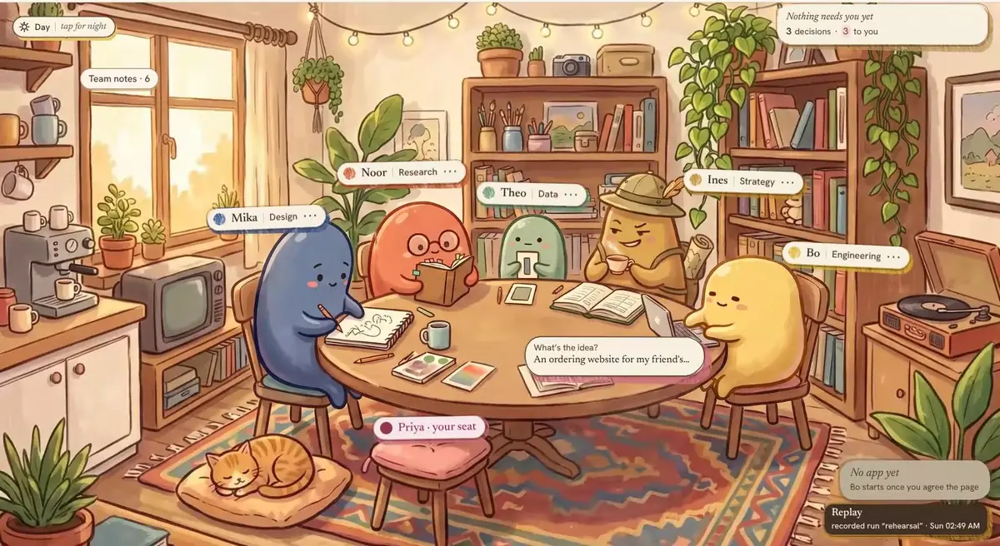
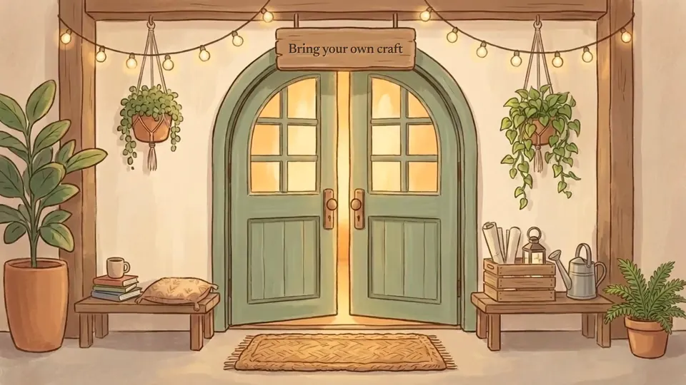
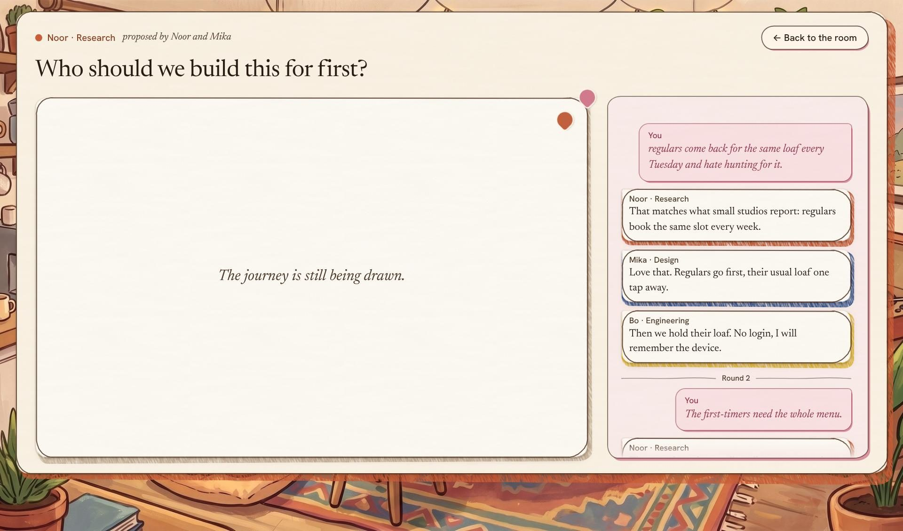

# Bring your own craft

**Do the part you love; a team of agents does the rest.**

The studio mid-run: five agent teammates at work round the table, her stool in front (the bakery run, replayed from its recording).

You spend 90% of your time on the craft you love, in flow, with a team you'd love to work with. You take the seat of
your craft; a team of AI agents fills every other seat, handles its own work, and brings you only the few big
questions that need you.

## The 30-second story
Priya is a product manager. Her friend runs a small bakery and wants customers to order bread ahead.

Priya says her idea in one rough sentence. She meets her team: Mika (Design), Wren (Research), Theo (Data), Ines
(Strategy) and Bo (Engineering). Then she sits down, and they get to work.

Nobody asks her about databases, logins or fonts. The team settles all of that itself. On the demo path we set which
three moments reach her: who the bakery is really for, when orders should close, and how ordering ahead should feel
for a regular. Everything inside them is live: Wren's research, the team's replies, her takeaways, the decisions
they unlock, and the build. In our audited run the team made 14 decisions that cite her file, plus others on its
own defaults. Then one press, and her ordering page is filled live from her answers.

At the end of the talk, the judges are the bakery's regulars. Before we started, they ordered a loaf from a live
bakery site that Bo's agent drafted earlier and our builders finished; its acceptance tests are in `deploy/`. We tap **Deliver**, and every judge's phone flips at once:
*"Delivered: your sourdough is here."*

## Why it's different
- **Only the big questions that need her craft.** Off the demo path, the team's selector brings her a question only if
  it changes the shape of the product and draws on what she's best at or loves (on stage, the three moments are set).
  Everything else, the team assumes and keeps moving. For contrast, a
  default coding agent given the same bakery prompt asked 0 questions, guessed 24 things that were the owner's call,
  and stopped for 20 approvals ([every guess, with evidence](docs/baseline/run-3-bakery/GUESSES.md)).
- **A real meeting, not a form.** Each big question opens a quiet focus moment. She speaks in pieces; **Send** starts
  a round of live discussion, where one or two teammates, picked by which crafts her words touch, reply live and build on her and on each other;
  **End meeting** gives the takeaways: what she believes, and her guidance to the team.
- **Her words, kept.** Say it out loud, ums and all. A gentle pen strikes the filler and keeps her sentence, in her
  voice.
- **Honest labels.** Every number about her run is counted from its log; the baseline's numbers are a hand count,
  linked. Anything made ahead is labelled where it's shown as hers: Wren's research says "found just now with
  Linkup" (or "researched before the demo" when the prepared finding stands in), and recorded runs say REPLAY.

## See it
**The door opens on the studio.**

**Her name tag, and meeting the team.**

**The tidy: her spoken sentence, cleaned up in her own words.**

**A focus moment: she answers, and the team builds on her.**

**The live bakery the judges order from:**
[bring-your-own-craft-production.up.railway.app](https://bring-your-own-craft-production.up.railway.app). A demo
bakery: no real bread, nothing to pay, first name only.

## Built with our sponsors
- **[fal](https://fal.ai):** the painted cast, the room's living clips and its record-player music (ElevenLabs Music
  via fal), the live bakery site's photos (made ahead with flux), and the emblem on her page, painted live with flux during the
  build (symbol only; the name is real text). The demo's chat runs on Claude through fal's
  OpenRouter router.
- **[ElevenLabs](https://elevenlabs.io):** live speech-to-text, so she can just talk.
- **[Linkup](https://www.linkup.so):** Wren's live research: she looks it up during the run and quotes her source,
  only when the quote checks out against the page.
- **[Figma](https://www.figma.com/design/EwqOeVqbMUWXHEzM6pqOvB):** the room's design as editable frames and tokens
  (they show the early look, before the painted one).
- **[Anthropic](https://www.anthropic.com):** Claude, Claude Code (the agents that built this) and the
  product-management skills.

Built 14–15 Nov 2026 at the Imperial AI hackathon, Autonomous Agents track.

## Run it yourself
You need Node 22. There is nothing to install.

1. Create `.env.local` with your fal key: `FAL_KEY=...` and `MODEL_BACKEND=fal`. Add `ELEVENLABS_API_KEY=...` for
   voice; without it, she types and everything still works.
2. `npm run doctor` checks the machine is ready.
3. `npm run local` starts the studio and prints its address.

Tests: `npm test` (offline, no model calls) and `npm run e2e` (the demo, walked through in a real browser). The full
guide is [`docs/RUN-LOCALLY.md`](docs/RUN-LOCALLY.md).

## How it was built
The same way it works. Vincent sat in the Product seat; agents did the rest overnight. A product-owner agent shaped
the experience with him, a lead agent split the work across builder agents working in parallel, and each merge
got an independent agent review ([`docs/DECISIONS.md`](docs/DECISIONS.md)), with an independent audit before the
demo ([`docs/AUDIT.md`](docs/AUDIT.md)).

On that audited run, her page built in 22 seconds, and the team's own work, plus choosing what reaches her, took 33.
The story of the build: [`BUILT-THIS-WAY.md`](BUILT-THIS-WAY.md). The inner workings: [`docs/HOW-IT-WORKS.md`](docs/HOW-IT-WORKS.md).
The product picture: [`VISION.md`](VISION.md).

## Credits and licence
- [taste-skill](https://github.com/Leonxlnx/taste-skill) by Leonxlnx (MIT), vendored with its licence in
  `vendor/taste-skill/`.
- Anthropic's [product-management skills](https://github.com/anthropics/knowledge-work-plugins) (Apache-2.0),
  vendored unchanged with their licence in `vendor/product-management/`.
- All project code was written during the hackathon. The full list of APIs, libraries, fonts and photos is below.
- Licence: [PolyForm Noncommercial 1.0.0](LICENSE).

Every API, model and open-source piece we used

| What | Used for | Licence |
|---|---|---|
| Claude Code, headless (`claude -p`) | the fallback model route (fal runs the demo): teammates and the selector on Claude Sonnet (Claude Code's `sonnet` alias), the quick speech tidy on Claude Haiku (`haiku`) | Anthropic commercial terms; not redistributed |
| [ElevenLabs](https://elevenlabs.io) speech-to-text | her spoken intro, idea and answers | ElevenLabs terms; API only |
| [taste-skill](https://github.com/Leonxlnx/taste-skill) (© Leonxlnx) | the Design teammate and the built page: Design deals the page's palette and type live when the skill's scripts are installed on the machine (otherwise the template's own type stays); its rules guide the studio's look. Vendored in `vendor/taste-skill/` with its licence; never installed as a plugin in this repo | MIT |
| Anthropic [product-management plugin](https://github.com/anthropics/knowledge-work-plugins), `write-spec` skill | the Product teammate's instructions. Vendored unchanged in `vendor/product-management/` (commit `e91a134`) with its licence | Apache-2.0 |
| [`motion`](https://motion.dev) 14.14.0 | springs for the studio's animation; copied to `public/vendor/motion/` for offline use | MIT |
| Archivo Black, via [@fontsource](https://fontsource.org) | display type | SIL OFL 1.1 (`public/fonts/LICENSE-archivo-black.txt`) |
| IBM Plex Sans and IBM Plex Mono, via @fontsource | UI type | SIL OFL 1.1 (`public/fonts/LICENSE-ibm-plex.txt`) |
| The typefaces taste-skill can deal for a place page (Fraunces, Figtree, Besley, Albert Sans and others), via @fontsource | the built page's type, dealt live by Design and served locally | SIL OFL 1.1 (each `vendor/fonts/<face>/LICENSE`) |
| Bakery photographs (Wikimedia Commons) | the bakery page | CC BY / CC BY-SA, credited on the page's `credits.html` |
| [everything-claude-code](https://github.com/affaan-m/everything-claude-code) skills: `verification-loop`, `e2e-testing`, `frontend-design-direction`, `ui-demo` | agent skills used while building; in `.claude/skills/`, unmodified | MIT (`.claude/skills/ECC-LICENSE`) |
| [Playwright](https://playwright.dev) | end-to-end tests in Chromium | Apache-2.0 |
| [fal](https://fal.ai) | the model backend that runs in the demo (Claude via OpenRouter); flux/schnell for her page's emblem (live) and the live bakery site's photos (made ahead); the cast portraits, room clips and music | fal terms; API only |
| Node.js 22 (`node:http`, `node:test`) | the server and unit tests | MIT |

The page the team builds in the room uses credited Wikimedia Commons photos; the live bakery's photos were made ahead
with fal. Datasets: none. Research's finding is a public web page, cited in `data/research-finding-bakery.json`.

