# Bring your own craft

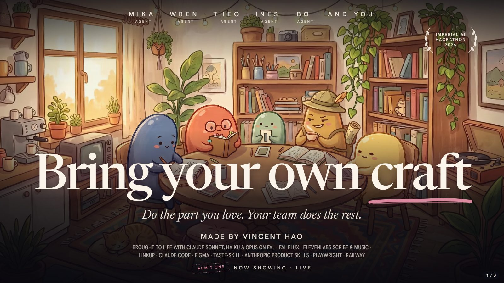

**Do the part you love; a team of agents does the rest.**

## Why I built this
I'm a builder at heart, and I love the craft: understanding people, deciding what's worth building, and writing some of the code too. But building with AI today pulls me away from it. **Coding agents ask about everything.** One prompt stopped for **20 approvals**, including which backend language to use. **AI app builders assume everything**, so it's hard to weave in my own craft and judgement. I wanted a way to spend 90% of my time on the part I love.

The baseline: a default coding agent on one bakery prompt asked 0 questions, guessed 24 things that were the owner's call, and stopped for 20 approvals ([every guess, with evidence](docs/baseline/run-3-bakery/GUESSES.md)).

## The story in 8 slides
The talk deck tells it best. The poster above is slide 1; here are the rest, in order.

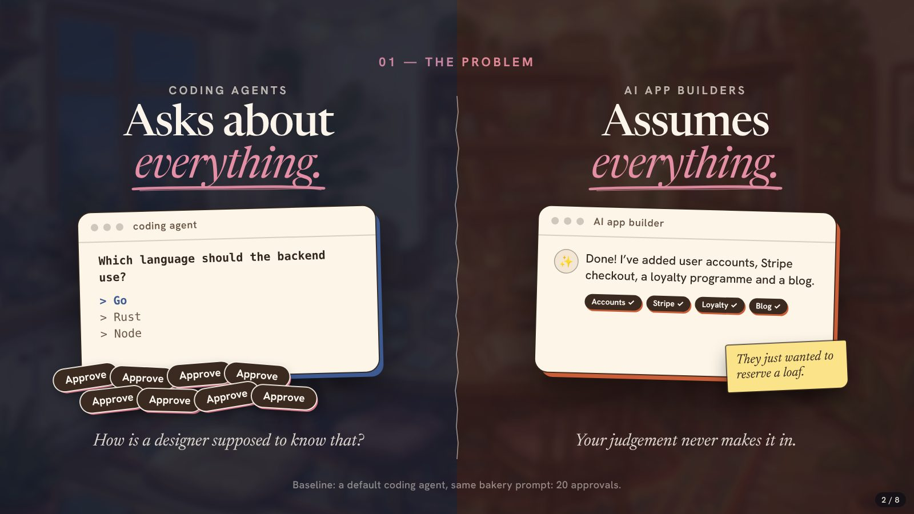
Coding agents ask about everything. AI app builders assume everything. Either way, my judgement never makes it in.

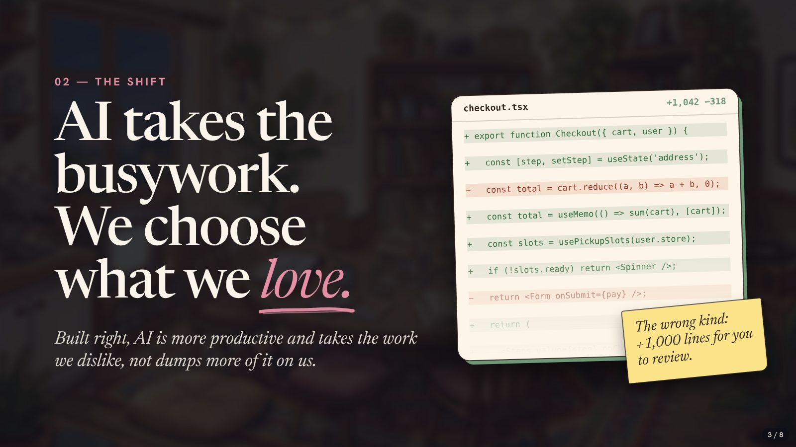
AI will outdo us. So we get to choose, and how we work has to change with it.

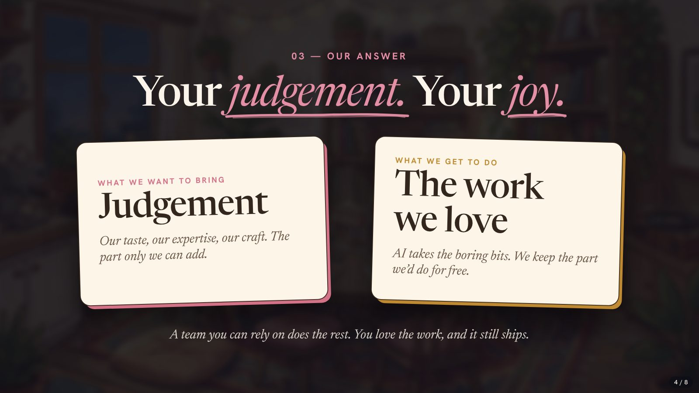
Your judgement. Your joy. What we want to bring, and the work we get to do.

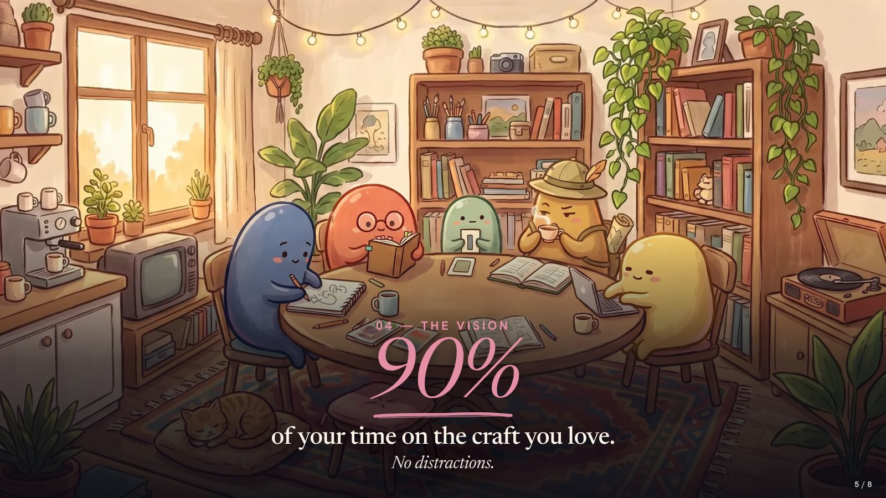
90% of your time on the craft you love. No distractions.

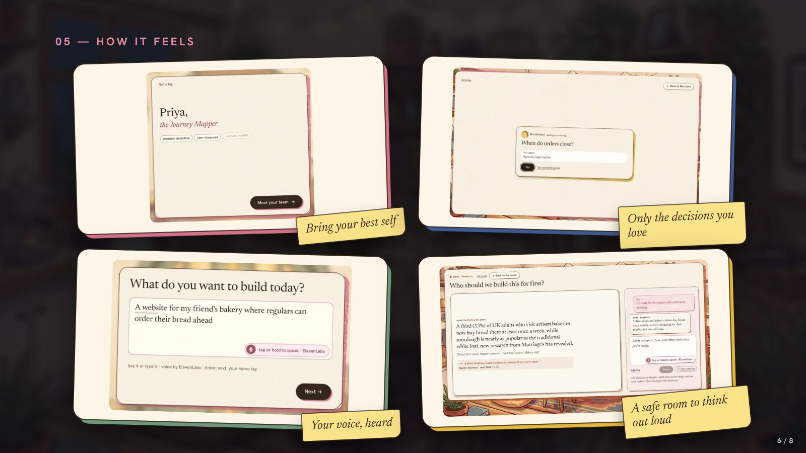
How it feels: bring your best self, your voice heard, only the decisions that matter, a safe room to think out loud.

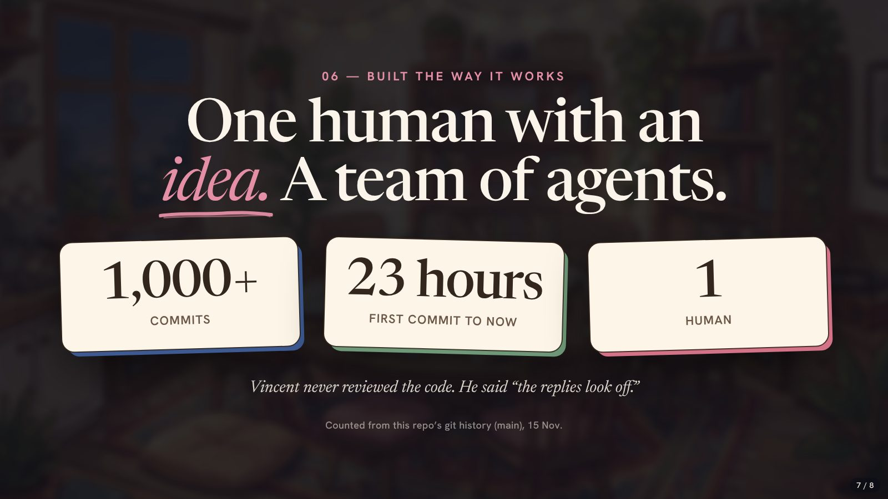
One human with an idea. A team of agents.

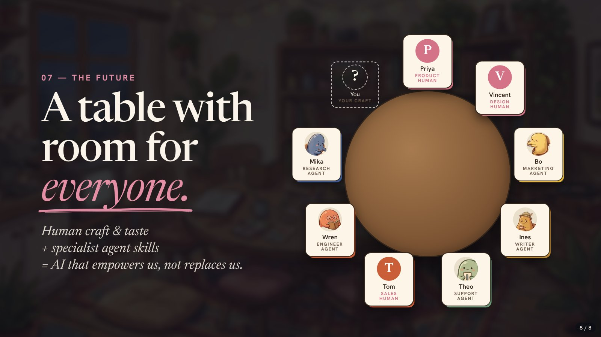
A table with room for everyone.

Present it yourself: `npm run local` → `/slides/talk.html` (or double-click `talk.html` at the repo root).

The studio mid-run: five agent teammates at work round the table, her stool in front (the bakery run, replayed from its recording).

## What I built
**Bring Your Own Craft** is a hand-painted studio where you take the seat of your craft, and a team of AI agents fills every other seat: **Mika** (Design), **Wren** (Research), **Theo** (Data), **Ines** (Strategy) and **Bo** (Engineering).

You say your idea in one rough sentence and meet your team. They get to know you, handle their own work, and bring you **only the few big questions that need your expertise**. Your app builds as you decide.

In the demo, a product manager gets a bakery ordering site, and the audience reserves a real loaf on the live site from their own phones.

In more detail: Priya, a product manager, wants an ordering site for her friend's bakery. She says her idea in one rough
sentence, gets a name tag, meets her team and sits down. Nobody asks her about databases or logins. Three moments
reach her, each about what she knows best: who the bakery is really for (Wren's research, found live), when orders
should close (one tap to unblock Bo), and how ordering ahead should feel for a regular. You can sit in any seat: pick
your craft on the name tag, and the teammate who held it steps aside.

At the end, pressing **Open the app** shows a QR card for The Usual, a live bakery Bo's agent drafted earlier and our
builders finished (built ahead, not in the room; source in [`deploy/`](deploy/README.md)). The audience scans it and
reserves a real loaf; I tap **Deliver**, and every phone flips at once to *"Delivered: your sourdough is here."*

## How it works
- **Only the big questions.** The team proposes decisions as it works. A selector ranks every one and brings you only
  what's big and in your craft; the team settles the rest itself and says why, citing what it knows about you. On
  stage the three moments are set so the talk fits three minutes; everything inside them is live.
- **A real meeting.** You speak in pieces, and a careful tidy removes the ums but keeps your words. **Send** starts a
  round where the teammates your words touch reply live; **End meeting** writes your takeaways.
- **Your app builds as you decide.** It starts on "Team, go", and each later decision builds the next version with a
  line on what changed. It fills one of three designed templates (bakery, café, yoga); the model never writes code.
  Its emblem is painted live with fal.
- **One model function.** Every call goes through `callModel` (`lib/model.js`) and returns JSON checked against a
  schema. Each teammate is its own call; in a discussion each turn reads the thread so far.
- **Honest labels.** Every number about a run is counted from its event log; anything made ahead says so on screen.

## How I built it
**One human with an idea and a team of agents.** I acted as product owner, and Claude Code agents worked as builders, designers, reviewers and a merger, each on its own branch, with every change reviewed before it reached `main`. That's over **1,000 commits in about 23 hours**.

- **Claude Sonnet, Haiku and Opus via fal** run the teammates
- **Linkup** powers Wren's live web search
- **ElevenLabs Scribe** handles speech, and **ElevenLabs Music** makes the soundtrack
- **fal** paints the studio art and each page's emblem
- **Figma** and **taste-skill** shape the look
- **Railway** hosts the live bakery site

## See it
**The door opens on the studio.**

**Her name tag, and meeting the team.**

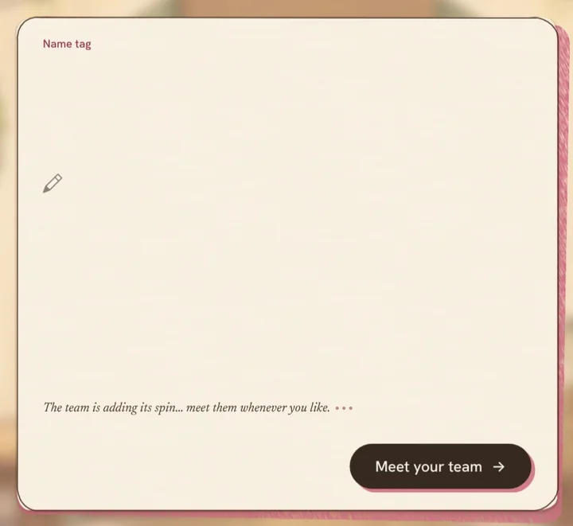

**The tidy: her spoken sentence, cleaned up in her own words.**

**A focus moment: she answers, and the team builds on her.**

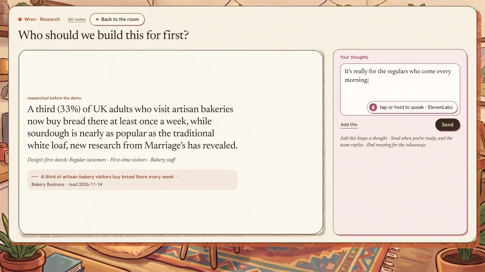

**When a teammate is blocked: one tap in her inbox, and the room carries on.**

**The Usual, the live bakery the judges order from:**
[bring-your-own-craft-production.up.railway.app](https://bring-your-own-craft-production.up.railway.app). A demo
bakery: no real bread, nothing to pay, first name only.

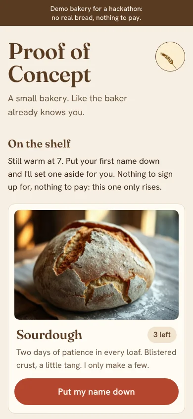

## APIs, models and datasets used
- **fal**, OpenRouter router: the models behind the demo. Claude Sonnet 4.5 for the teammates, the selector, her
  profile, the sketch and the page fill; Claude Haiku 4.5 for the fast calls (the tidy, her name tag, the team's
  replies and discussion); Claude Opus for her takeaways and revisiting decisions (`lib/model.js`, `FAL_MODELS` and
  each `*_MODEL` default).
- **fal**, flux/schnell: her page's emblem, painted live; the live bakery's photos, made ahead. The studio's painted
  cast, clips and music were made ahead on fal.
- **Claude via Claude Code**, headless: the fallback route for the same calls (`MODEL_BACKEND=claude-code`).
- **ElevenLabs**: Scribe speech-to-text, live, for her voice; ElevenLabs Music (through fal) for the record player's
  soundtrack.
- **Linkup**: Wren's live web search.
- **taste-skill** (MIT, third-party, vendored in `vendor/taste-skill/`): the Design teammate's rules and the page's
  palette and type.
- **Anthropic product-management skills** (Apache-2.0, vendored): `write-spec`, in the Product teammate's prompt.
- **Playwright**: end-to-end tests.
- **Photographs**: the bakery and café templates use Wikimedia Commons photos under CC BY and CC BY-SA, credited per
  photo on each template's `credits.html` (the bakery: Johann Jaritz, CC BY-SA 3.0 AT; Chmee2, CC BY 3.0;
  Wald1siedel, CC BY-SA 4.0).
- **Datasets**: none. Wren's prepared finding is one public web page, cited in `data/research-finding-bakery.json`.

The full table, with fonts and libraries, is under [Credits and licence](#credits-and-licence).

## Built during the hackathon
All project code was written during the hackathon (14–15 Nov 2026). The third-party pieces are open source and
credited: taste-skill (MIT) and Anthropic's product-management skills (Apache-2.0), vendored with their licences, plus
the fonts, `motion` and Playwright listed below. The models are used through their APIs.

## Figma
We went from code to Figma. The running room was measured in the browser and rebuilt as editable Figma frames, with
its colours and spacing as a Figma variable collection ("Room tokens"), its type and its seat glyphs, so a designer
can pick it up and tweak it: [the Figma file](https://www.figma.com/design/EwqOeVqbMUWXHEzM6pqOvB). How it was done,
frame by frame: [`design/FIGMA.md`](design/FIGMA.md). The frames show the room's early look, before the painted one.

## Built with our sponsors
fal, ElevenLabs, Linkup, Figma and Anthropic, as above. Built 14–15 Nov 2026 at the Imperial AI hackathon, Autonomous
Agents track.

## What's next
*Where I'm heading, not what's built yet.*

**A new way of working.** A lot of work will stop being economically productive for people to do. I want to build a
way of working with AI agents that preserves our craft and imagination, and lets us spend more than 90% of our time
doing what we love.

AI will outdo us at a lot of work, and that means we get to choose what we do. What we bring is our judgement, and
the joy of doing the part we love.

**A team that keeps what it learns about you.** Every tool today starts from zero, so you explain yourself again on
every project. Your team should keep its own picture of you: your customers, your taste, your philosophy as it
emerges from what you say. It uses that to decide the way you would, and asks you less as it gets to know you.

**Every craft gets a seat.** I'm starting with product managers like Priya, because they know customers and journeys
inside out and have more ideas than people to build them. The same shape fits a designer, a researcher, or a baker
with a business idea: you take the seat of your craft, and the team fills the rest.

**A table with room for everyone.** Next, real people join the table: invite a real engineer to the Engineering seat,
and they bring their own team of agents. People and agents side by side, everyone doing what they're best at.

## Run it yourself
You need Node 22. There is nothing to install.

1. Create `.env.local` with your fal key: `FAL_KEY=...` and `MODEL_BACKEND=fal`. Add `ELEVENLABS_API_KEY=...` for
   voice; without it, she types and everything still works.
2. `npm run doctor` checks the machine is ready.
3. `npm run local` starts the studio and prints its address.

Tests: `npm test` (offline, no model calls) and `npm run e2e` (the demo, walked through in a real browser; it needs
Playwright: `npm i -g playwright && npx playwright install chromium`). The room listens on this machine only (loopback);
`HOST=0.0.0.0` opens it to the network on purpose. The full guide is [`docs/RUN-LOCALLY.md`](docs/RUN-LOCALLY.md).

## Credits and licence
- [taste-skill](https://github.com/Leonxlnx/taste-skill) by Leonxlnx (MIT), vendored with its licence in
  `vendor/taste-skill/`.
- Anthropic's [product-management skills](https://github.com/anthropics/knowledge-work-plugins) (Apache-2.0),
  vendored unchanged with their licence in `vendor/product-management/`.
- Licence: [PolyForm Noncommercial 1.0.0](LICENSE).

Every API, model and open-source piece we used

| What | Used for | Licence |
|---|---|---|
| Claude Code, headless (`claude -p`) | the fallback model route (fal runs the demo): teammates and the selector on Claude Sonnet (Claude Code's `sonnet` alias), the quick speech tidy on Claude Haiku (`haiku`) | Anthropic commercial terms; not redistributed |
| [ElevenLabs](https://elevenlabs.io) speech-to-text and ElevenLabs Music | her spoken intro, idea and answers; the record player's soundtrack (made through fal) | ElevenLabs terms; API only |
| [taste-skill](https://github.com/Leonxlnx/taste-skill) (© Leonxlnx) | the Design teammate and the built page: Design deals the page's palette and type live when the skill's scripts are installed on the machine (otherwise the template's own type stays); its rules guide the studio's look. Vendored in `vendor/taste-skill/` with its licence; never installed as a plugin in this repo | MIT |
| Anthropic [product-management plugin](https://github.com/anthropics/knowledge-work-plugins), `write-spec` skill | the Product teammate's instructions. Vendored unchanged in `vendor/product-management/` (commit `e91a134`) with its licence | Apache-2.0 |
| [`motion`](https://motion.dev) 14.14.0 | springs for the studio's animation; copied to `public/vendor/motion/` for offline use | MIT |
| Archivo Black, via [@fontsource](https://fontsource.org) | display type | SIL OFL 1.1 (`public/fonts/LICENSE-archivo-black.txt`) |
| IBM Plex Sans and IBM Plex Mono, via @fontsource | UI type | SIL OFL 1.1 (`public/fonts/LICENSE-ibm-plex.txt`) |
| The typefaces taste-skill can deal for a place page (Fraunces, Figtree, Besley, Albert Sans and others), via @fontsource | the built page's type, dealt live by Design and served locally | SIL OFL 1.1 (each `vendor/fonts/<face>/LICENSE`) |
| Bakery photographs (Wikimedia Commons) | the bakery page | CC BY / CC BY-SA, credited on the page's `credits.html` |
| [everything-claude-code](https://github.com/affaan-m/everything-claude-code) skills: `verification-loop`, `e2e-testing`, `frontend-design-direction`, `ui-demo` | agent skills used while building; in `.claude/skills/`, unmodified | MIT (`.claude/skills/ECC-LICENSE`) |
| [Playwright](https://playwright.dev) | end-to-end tests in Chromium | Apache-2.0 |
| [fal](https://fal.ai) | the model backend that runs in the demo (Claude via OpenRouter); flux/schnell for her page's emblem (live) and the live bakery site's photos (made ahead); the cast portraits, room clips and music | fal terms; API only |
| Node.js 22 (`node:http`, `node:test`) | the server and unit tests | MIT |

