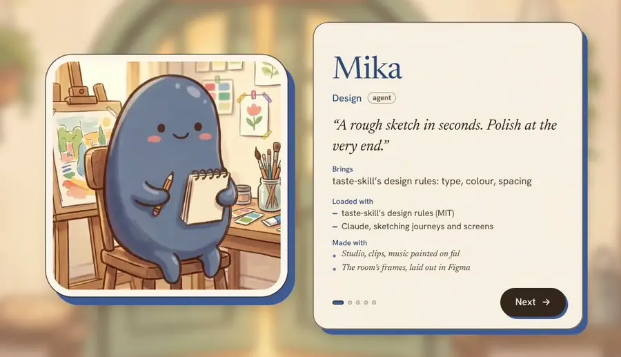
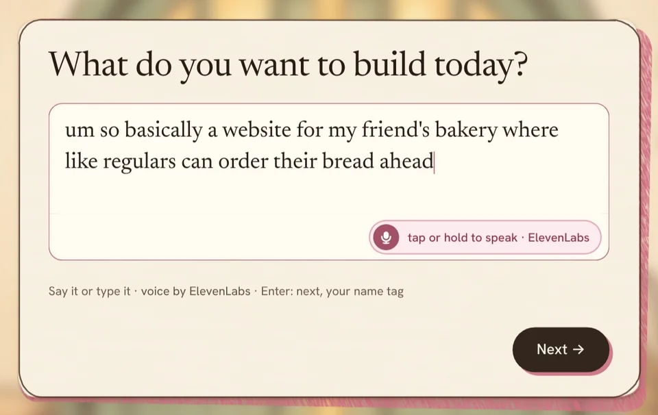
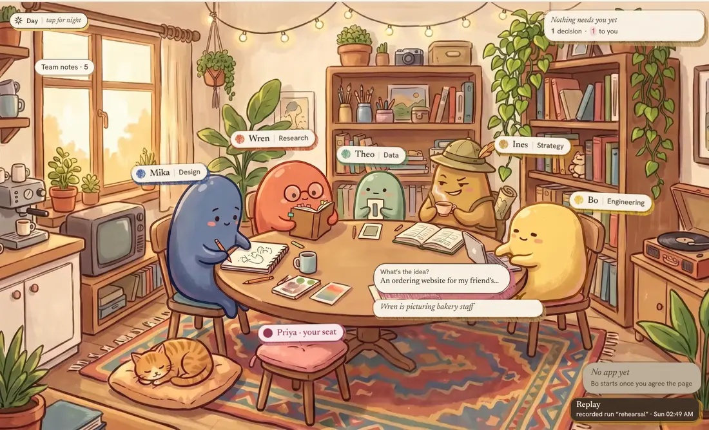

# Bring your own craft

**Do the part you love; a team of agents does the rest.**

The studio mid-run: five agent teammates at work round the table, her stool in front (the bakery run, replayed from its recording).

You spend 90% of your time on the craft you love, in flow, with a team you'd love to work with. You take the seat of
your craft; a team of AI agents fills every other seat, handles its own work, and brings you only the few big
questions that need you.

## The problem
Most projects don't die from bad ideas. They die in the questions nobody signed up for. AI app builders guess
everything, so a product manager's expertise never makes it in. Coding agents ask about everything: approvals,
databases, fonts. We measured it: a default coding agent given one bakery prompt asked 0 questions, guessed 24 things
that were the owner's call, and stopped for 20 approvals ([every guess, with evidence](docs/baseline/run-3-bakery/GUESSES.md)).

## What I built
A hand-painted studio where you take the seat of your craft, and a team of AI agents fills the rest: Mika (Design),
Wren (Research), Theo (Data), Ines (Strategy) and Bo (Engineering), each with its own craft and tools.

In the demo, Priya, a product manager, wants an ordering site for her friend's bakery. She says the idea in one rough
sentence, gets a name tag, meets her team, and sits down. Nobody asks her about databases or logins. Three moments
reach her, each about what she knows best: who the bakery is really for (Wren's research, found live), when orders
should close (one tap to unblock Bo), and how ordering ahead should feel for a regular. Then one press, and her
ordering page is filled from her answers.

Two more things you can see happen: **sit in any seat** (pick your craft on the name tag; the teammate who held it
steps aside; Product is the default and the demo seat), and **your app starts building the moment you say Team, go**;
each later decision builds the next version, with a line on what changed.

At the end, the judges become the bakery's regulars. Pressing **Open the app** shows a QR card for The Usual, a live
bakery that Bo's agent drafted earlier and our builders finished (built ahead, not in the room; source in
[`deploy/`](deploy/README.md)). The judges scan it and reserve a real loaf; we tap **Deliver**, and every phone flips
at once to *"Delivered: your sourdough is here."*

## How it works
- **One model function.** Every call goes through `callModel` (`lib/model.js`) and returns JSON checked against a
  schema. Each teammate is its own call with its own craft and stance; in a discussion each turn is a separate call
  that reads the thread so far.
- **Only the big questions.** The team proposes decisions as it works and settles the small ones itself, citing her
  file or its own defaults. Off the demo path, a selector ranks every candidate and brings her only what's big and in
  her craft. On stage, the three moments are set so the talk fits three minutes; everything inside them is live.
- **A real meeting.** She speaks in pieces (a guarded tidy removes the ums and keeps her words). **Send** starts a
  round where one or two teammates, picked by which crafts her words touch, reply live. **End meeting** writes her
  takeaways: what she believes, and her guidance to the team.
- **Live tools.** Wren searches with Linkup and quotes a finding only when the quote matches the source page word for
  word (otherwise a prepared finding, labelled). The build fills one of three designed page templates (bakery, café,
  yoga) with her decisions; the model never writes code. Her page's emblem is painted live with fal.
- **Honest labels.** Every number about her run is counted from its event log. Anything made ahead is labelled where
  it shows: "researched before the demo", PREPARED, REPLAY.

## See it
**The door opens on the studio.**

**Her name tag, and meeting the team.**

**The tidy: her spoken sentence, cleaned up in her own words.**

**A focus moment: she answers, and the team builds on her.**

**When a teammate is blocked: one tap in her inbox, and the room carries on.**

**The Usual, the live bakery the judges order from:**
[bring-your-own-craft-production.up.railway.app](https://bring-your-own-craft-production.up.railway.app). A demo
bakery: no real bread, nothing to pay, first name only.

## APIs, models and datasets used
- **fal**, OpenRouter router: the models behind the demo. Claude Sonnet 4.5 for the teammates, the selector, her
  profile, the sketch and the page fill; Claude Haiku 4.5 for the fast calls (the tidy, her name tag, the team's
  replies and discussion); Claude Opus for her takeaways and revisiting decisions (`lib/model.js`, `FAL_MODELS` and
  each `*_MODEL` default).
- **fal**, flux/schnell: her page's emblem, painted live; the live bakery's photos, made ahead. The studio's painted
  cast, clips and music were made ahead on fal.
- **Claude via Claude Code**, headless: the fallback route for the same calls (`MODEL_BACKEND=claude-code`).
- **ElevenLabs**: Scribe speech-to-text, live, for her voice; ElevenLabs Music (through fal) for the record player's
  soundtrack.
- **Linkup**: Wren's live web search.
- **taste-skill** (MIT, third-party, vendored in `vendor/taste-skill/`): the Design teammate's rules and the page's
  palette and type.
- **Anthropic product-management skills** (Apache-2.0, vendored): `write-spec`, in the Product teammate's prompt.
- **Playwright**: end-to-end tests.
- **Photographs**: the bakery and café templates use Wikimedia Commons photos under CC BY and CC BY-SA, credited per
  photo on each template's `credits.html` (the bakery: Johann Jaritz, CC BY-SA 3.0 AT; Chmee2, CC BY 3.0;
  Wald1siedel, CC BY-SA 4.0).
- **Datasets**: none. Wren's prepared finding is one public web page, cited in `data/research-finding-bakery.json`.

The full table, with fonts and libraries, is under [Credits and licence](#credits-and-licence).

## Built during the hackathon
All project code was written during the hackathon (14–15 Nov 2026). The third-party pieces are open source and
credited: taste-skill (MIT) and Anthropic's product-management skills (Apache-2.0), vendored with their licences, plus
the fonts, `motion` and Playwright listed below. The models are used through their APIs.

## Figma
We went from code to Figma. The running room was measured in the browser and rebuilt as editable Figma frames, with
its colours and spacing as a Figma variable collection ("Room tokens"), its type and its seat glyphs, so a designer
can pick it up and tweak it: [the Figma file](https://www.figma.com/design/EwqOeVqbMUWXHEzM6pqOvB). How it was done,
frame by frame: [`design/FIGMA.md`](design/FIGMA.md). The frames show the room's early look, before the painted one.

## Built with our sponsors
fal, ElevenLabs, Linkup, Figma and Anthropic, as above. Built 14–15 Nov 2026 at the Imperial AI hackathon, Autonomous
Agents track.

## Run it yourself
You need Node 22. There is nothing to install.

1. Create `.env.local` with your fal key: `FAL_KEY=...` and `MODEL_BACKEND=fal`. Add `ELEVENLABS_API_KEY=...` for
   voice; without it, she types and everything still works.
2. `npm run doctor` checks the machine is ready.
3. `npm run local` starts the studio and prints its address.

Tests: `npm test` (offline, no model calls) and `npm run e2e` (the demo, walked through in a real browser; it needs
Playwright: `npm i -g playwright && npx playwright install chromium`). The room listens on this machine only (loopback);
`HOST=0.0.0.0` opens it to the network on purpose. The full guide is [`docs/RUN-LOCALLY.md`](docs/RUN-LOCALLY.md).

## How it was built
The same way it works. Vincent sat in the Product seat; agents did the rest overnight. A product-owner agent shaped
the experience with him, a lead agent split the work across builder agents working in parallel, and each merge
got an independent agent review ([`docs/DECISIONS.md`](docs/DECISIONS.md)), with an independent audit before the
demo ([`docs/AUDIT.md`](docs/AUDIT.md)).

On that audited run, her page built in 22 seconds, and the team's own work took 33.
The story of the build: [`BUILT-THIS-WAY.md`](BUILT-THIS-WAY.md). The inner workings: [`docs/HOW-IT-WORKS.md`](docs/HOW-IT-WORKS.md).
The product picture: [`VISION.md`](VISION.md).

## Credits and licence
- [taste-skill](https://github.com/Leonxlnx/taste-skill) by Leonxlnx (MIT), vendored with its licence in
  `vendor/taste-skill/`.
- Anthropic's [product-management skills](https://github.com/anthropics/knowledge-work-plugins) (Apache-2.0),
  vendored unchanged with their licence in `vendor/product-management/`.
- Licence: [PolyForm Noncommercial 1.0.0](LICENSE).

Every API, model and open-source piece we used

| What | Used for | Licence |
|---|---|---|
| Claude Code, headless (`claude -p`) | the fallback model route (fal runs the demo): teammates and the selector on Claude Sonnet (Claude Code's `sonnet` alias), the quick speech tidy on Claude Haiku (`haiku`) | Anthropic commercial terms; not redistributed |
| [ElevenLabs](https://elevenlabs.io) speech-to-text and ElevenLabs Music | her spoken intro, idea and answers; the record player's soundtrack (made through fal) | ElevenLabs terms; API only |
| [taste-skill](https://github.com/Leonxlnx/taste-skill) (© Leonxlnx) | the Design teammate and the built page: Design deals the page's palette and type live when the skill's scripts are installed on the machine (otherwise the template's own type stays); its rules guide the studio's look. Vendored in `vendor/taste-skill/` with its licence; never installed as a plugin in this repo | MIT |
| Anthropic [product-management plugin](https://github.com/anthropics/knowledge-work-plugins), `write-spec` skill | the Product teammate's instructions. Vendored unchanged in `vendor/product-management/` (commit `e91a134`) with its licence | Apache-2.0 |
| [`motion`](https://motion.dev) 14.14.0 | springs for the studio's animation; copied to `public/vendor/motion/` for offline use | MIT |
| Archivo Black, via [@fontsource](https://fontsource.org) | display type | SIL OFL 1.1 (`public/fonts/LICENSE-archivo-black.txt`) |
| IBM Plex Sans and IBM Plex Mono, via @fontsource | UI type | SIL OFL 1.1 (`public/fonts/LICENSE-ibm-plex.txt`) |
| The typefaces taste-skill can deal for a place page (Fraunces, Figtree, Besley, Albert Sans and others), via @fontsource | the built page's type, dealt live by Design and served locally | SIL OFL 1.1 (each `vendor/fonts/<face>/LICENSE`) |
| Bakery photographs (Wikimedia Commons) | the bakery page | CC BY / CC BY-SA, credited on the page's `credits.html` |
| [everything-claude-code](https://github.com/affaan-m/everything-claude-code) skills: `verification-loop`, `e2e-testing`, `frontend-design-direction`, `ui-demo` | agent skills used while building; in `.claude/skills/`, unmodified | MIT (`.claude/skills/ECC-LICENSE`) |
| [Playwright](https://playwright.dev) | end-to-end tests in Chromium | Apache-2.0 |
| [fal](https://fal.ai) | the model backend that runs in the demo (Claude via OpenRouter); flux/schnell for her page's emblem (live) and the live bakery site's photos (made ahead); the cast portraits, room clips and music | fal terms; API only |
| Node.js 22 (`node:http`, `node:test`) | the server and unit tests | MIT |

